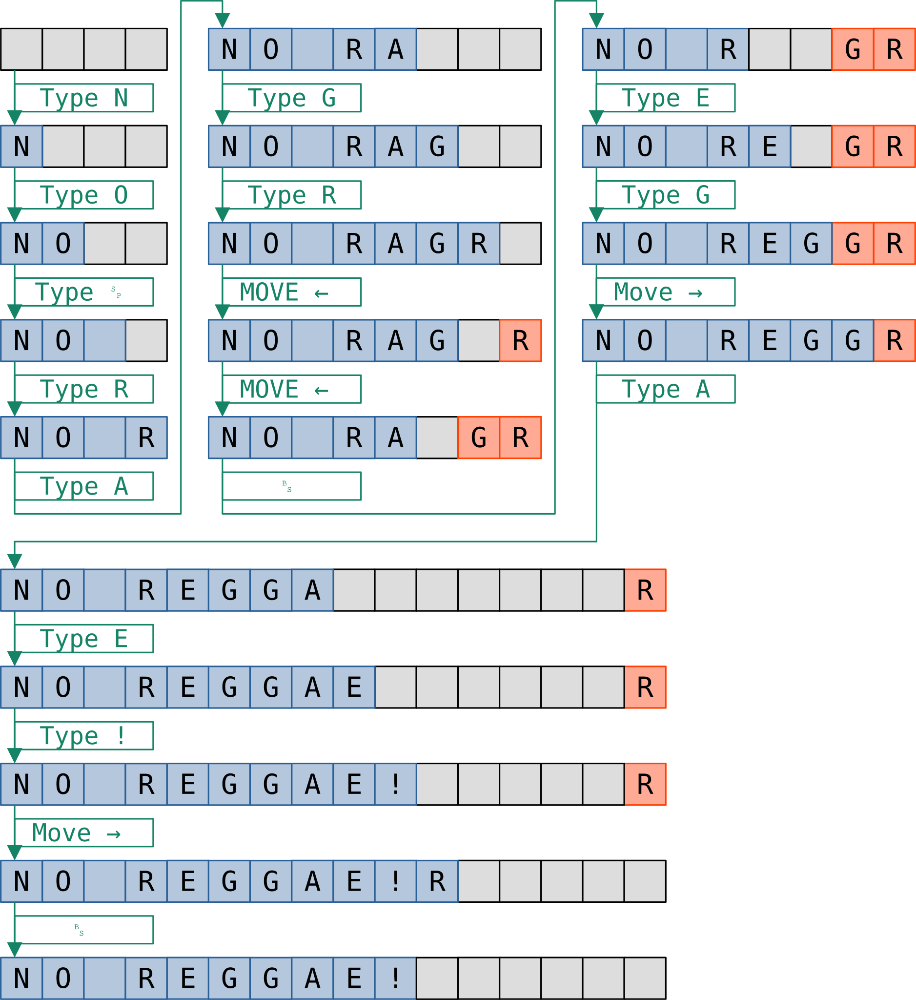

# Task 1 - Gap buffer

## Motivation

Text editors (like the one that you are using right now) need to store the contents of the text file in memory somehow. 
The natural first idea is to use a dynamic array of characters for the content, and a simple unsigned integer index variable for cursor position.
This solution, however, becomes subpar when we look at typical operations that need to be supported.

Three basic operations we will focus on.
 - move cursor left/right
 - type where the cursor is
 - delete with backspace

With the dynarray implementation moving would be O(1), as it just increments/decrements the cursor index.
Deleting a character or typing in a new character, however, would require O(n) time due to shifting the part after the cursor.

## Gap buffer

Gap buffer is a simple solution to this issue. The memory layout of the solution is still a dynamically allocated array. 
Everything before the cursor is at the beginning of the array just as before.
The trick is, that the part of the file that is to the right of the cursor is not right after that, but at the end of this buffer, and the "free spaces" are in the middle.


All aforementioned operations can now be implemented in O(1) time:
 - moving left/right: moving/copying 1 character from left to right / right to left at the borders of the "free zone"
 - typing: the typed characters are inserted at the left end of the "free zone"
 - backspace: the character left to the "free zone" is added to the "free zone"

These are illustrated below:



Note, that if the buffer gets full, reallocation needs to be similarly done as with a regular dynamic array.

## Exercise

Implement the empty functions in [gap_buffer.c](gap_buffer.c).

`main` is not allowed to be changed. 

The `debug` function should print out the state of the buffer in such a way that it allows debugging, i.e., one can observe the front/back part of the buffer and the length of the "free zone".

An example output could look like this:

```
This!_____                                    ===>     This!|
This_____!                                    ===>     This|!
This is a ni_______!                          ===>     This is a ni|!
This is a nice Rap buffer______________!      ===>     This is a nice Rap buffer|!
This is a nice Rap buffe______________r!      ===>     This is a nice Rap buffe|r!
This is a nice Rap buff______________er!      ===>     This is a nice Rap buff|er!
This is a nice Rap buf______________fer!      ===>     This is a nice Rap buf|fer!
This is a nice Rap bu______________ffer!      ===>     This is a nice Rap bu|ffer!
This is a nice Rap b______________uffer!      ===>     This is a nice Rap b|uffer!
This is a nice Rap ______________buffer!      ===>     This is a nice Rap |buffer!
This is a nice Rap______________ buffer!      ===>     This is a nice Rap| buffer!
This is a nice Ra______________p buffer!      ===>     This is a nice Ra|p buffer!
This is a nice R______________ap buffer!      ===>     This is a nice R|ap buffer!
This is a nice Ga______________p buffer!      ===>     This is a nice Ga|p buffer!
This is a nice Gap______________ buffer!      ===>     This is a nice Gap| buffer!
This is a nice Gap ______________buffer!      ===>     This is a nice Gap |buffer!
This is a nice Gap b______________uffer!      ===>     This is a nice Gap b|uffer!
This is a nice Gap bu______________ffer!      ===>     This is a nice Gap bu|ffer!
This is a nice Gap buf______________fer!      ===>     This is a nice Gap buf|fer!
This is a nice Gap buff______________er!      ===>     This is a nice Gap buff|er!
This is a nice Gap buffe______________r!      ===>     This is a nice Gap buffe|r!
This is a nice Gap buffer______________!      ===>     This is a nice Gap buffer|!
This is a nice Gap buffer!______________      ===>     This is a nice Gap buffer!|
This is a nice Gap buffer! ;-) _________      ===>     This is a nice Gap buffer! ;-) |
```

Left side is the memory layout, right side is what we would see in the text editor, where `|` indicates the position of the cursor. Just doing the left side or the right side + printing out the size of the free zone is enough, for example.