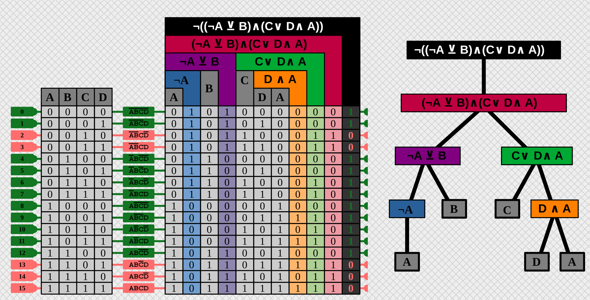
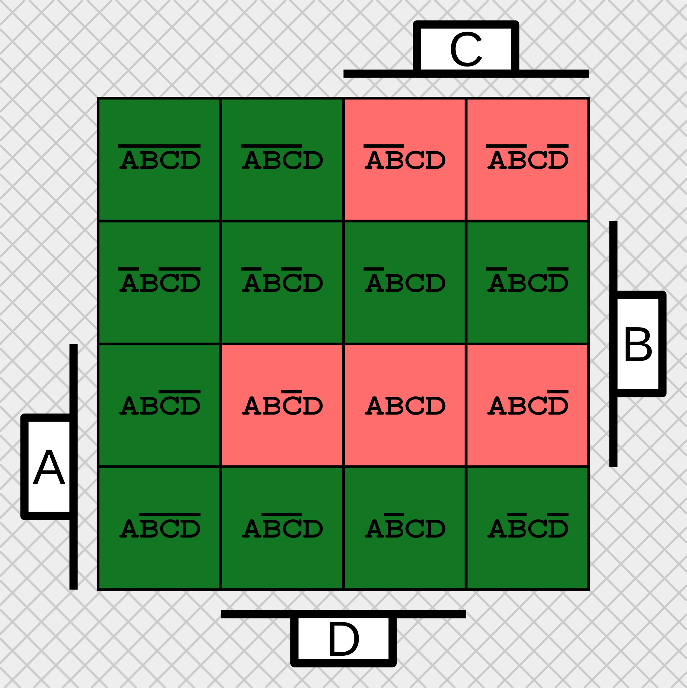
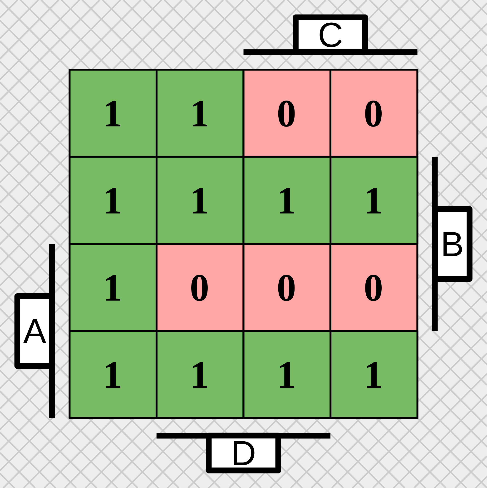
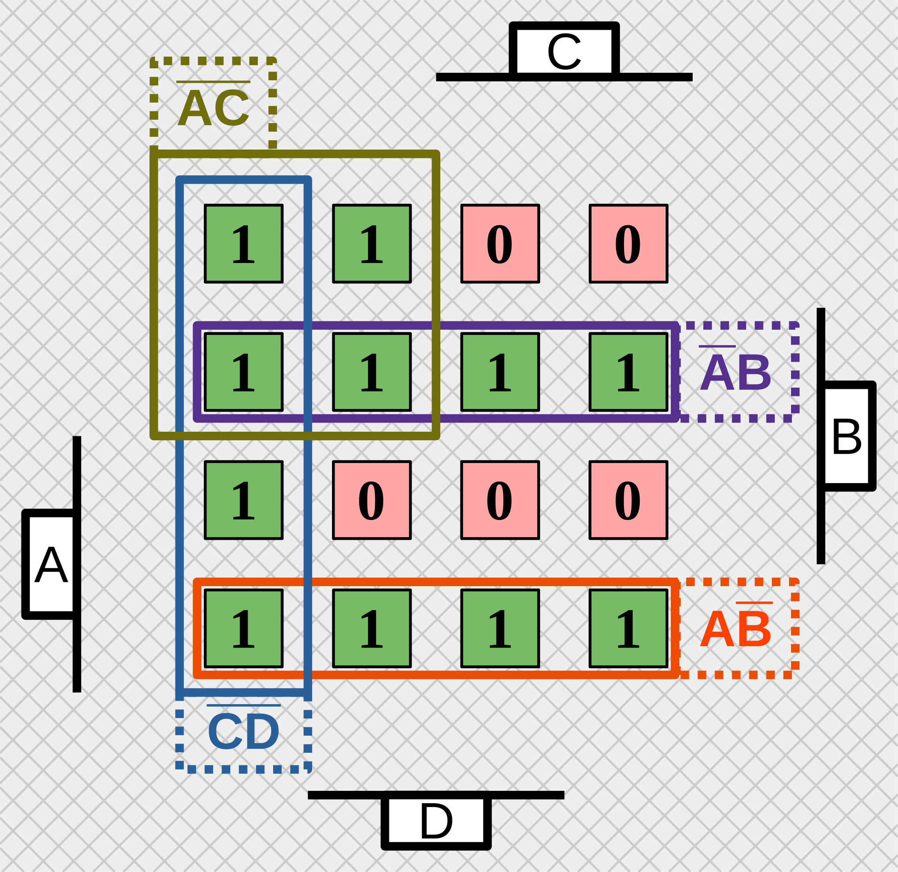

# Solution

> [!NOTE]
> For the sake of practicing, different notations are used in different stages of the solution.

## Truth table

It usually helps to visualize the expression as a tree:
```
           NOT
            |
           AND
          /   \
       XOR     OR
      /   \   /  \
    NOT    B C   AND
     |          /   \
     A         D     A
```

Now it is easier to do each node in the tree step-by-step from bottom to top. (Making the truth table of `D and A` from `D` and `A`, then using that and the column `C` to do `C OR D AND A`, etc.)



## DNF

Only minterms 2,3,13,14,15 are 0, so the DNF looks like this:

$$
    \bar{A}\bar{B}\bar{C}\bar{D} + 
    \bar{A}\bar{B}\bar{C}    {D} + 
%    \bar{A}\bar{B}    {C}\bar{D} + 
%    \bar{A}\bar{B}    {C}    {D} +  
    \newline 
    \bar{A}    {B}\bar{C}\bar{D} + 
    \bar{A}    {B}\bar{C}    {D} + 
    \bar{A}    {B}    {C}\bar{D} + 
    \bar{A}    {B}    {C}    {D} + 
    \newline
        {A}\bar{B}\bar{C}\bar{D} + 
        {A}\bar{B}\bar{C}    {D} + 
        {A}\bar{B}    {C}\bar{D} + 
        {A}\bar{B}    {C}    {D} + 
    \newline
        {A}    {B}\bar{C}\bar{D}
%        {A}    {B}\bar{C}    {D} + 
%        {A}    {B}    {C}\bar{D} + 
%        {A}    {B}    {C}    {D} + 
$$

## Minimizing DNF

Putting the true/1 minterms into the Karnaugh table/map: 



Leaving just the 1s and 0s:



Now we just have to cover all the 1s with rectangles, the fewer and larger the better. (rectangle sides must be 1,2 or 4). Luckily, everything can be covered by 4 rectangles of size 4. There are multiple ways to do this, an example:




So, (one) minimal DNF is: $\bar{A}\bar{C} + \bar{A}B + A\bar{B} + \bar{C}\bar{D}$